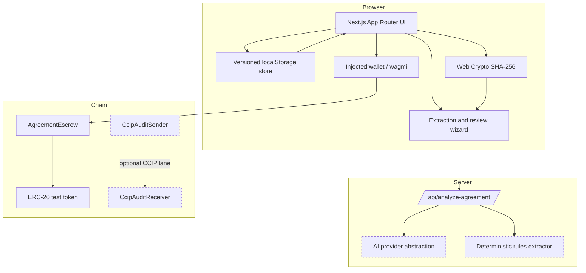
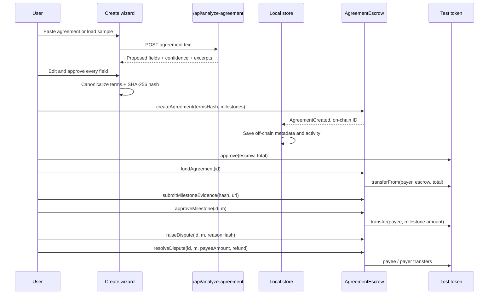
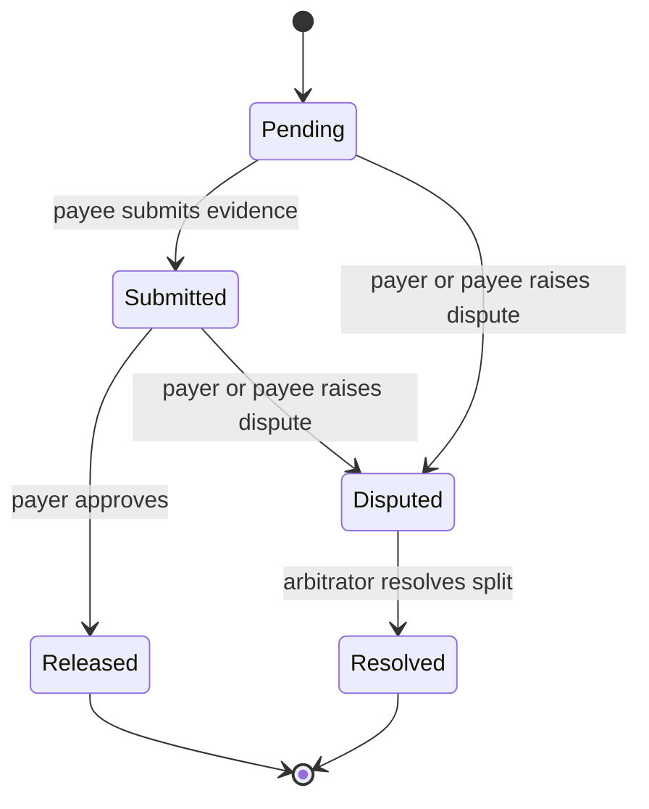
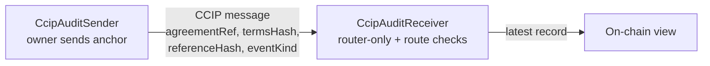
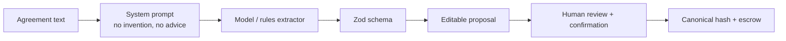

# PactRail Architecture

## 1. System overview

PactRail is a single Next.js application with an optional Solidity escrow layer. Off-chain agreement metadata and the reviewed terms live in the browser; only the canonical terms hash, milestone schedule, evidence hashes, and settlement state are committed to the escrow contract.



### Runtime modes

| Mode | Persistence | Settlement actions | Labelling |
| --- | --- | --- | --- |
| Demo | localStorage | Simulated demo events | `Demo event`, no transaction hash |
| Live | localStorage metadata + on-chain state | Injected wallet transactions | `On-chain`, explorer link when available |

Demo and live records are stored in the same local store but separated by `mode`. Switching workspace never converts a demo record into a live one. The live workspace can read on-chain milestone state even without a connected wallet if an RPC is configured.

## 2. Main flow



### Canonical terms

The approved terms object is normalized with sorted keys:

```json
{
  "version": "pactrail.terms.v1",
  "title": "...",
  "summary": "...",
  "parties": {
    "payer": { "name": "...", "address": "0x..." },
    "payee": { "name": "...", "address": "0x..." },
    "arbitrator": { "name": "...", "address": "0x..." }
  },
  "token": { "symbol": "USDC", "address": "0x...", "decimals": 6 },
  "totalAmountBaseUnits": "5000000000",
  "milestones": [
    {
      "index": 0,
      "description": "Design approval",
      "acceptanceCriteria": "...",
      "amountBaseUnits": "1000000000",
      "dueAt": "2026-11-14T23:59:59.000Z"
    }
  ],
  "jurisdictionContext": "England and Wales",
  "chainId": 84532
}
```

The exact canonical JSON is hashed with SHA-256. The on-chain `termsHash` is immutable. The UI compares the local hash with the on-chain hash when live state is available and surfaces a warning on mismatch.

Amounts stay as integer strings/base units through the domain layer. Formatting and decimal parsing happen only at the UI or chain boundary. Viem `parseUnits` parses user input; display code uses BigInt division, never floating-point arithmetic.

## 3. Agreement and milestone state

### Agreement status (derived off-chain)

| Status | Derivation |
| --- | --- |
| Draft | Terms not approved |
| Awaiting funding | Approved, no funded timestamp |
| Active | Funded, no submitted/disputed milestones, not all settled |
| Awaiting approval | At least one submitted milestone |
| Disputed | At least one disputed milestone |
| Completed | All milestones released, resolved, or refunded |

The on-chain enum is simpler: `None`, `Created`, `Funded`, `Completed`. Off-chain derived status is presentation logic over the local milestone mirror; live reads merge with on-chain milestones.

### Milestone state machine



UI status `Refunded` is derived from a resolved on-chain milestone whose full amount went to the payer. UI status `Resolved` covers partial or full payee awards.

## 4. Smart contracts

### `AgreementEscrow.sol`

Responsibilities:

- Store agreement parties, token, total, terms hash, status, and milestone schedule.
- Enforce the payer/payee/arbitrator role for every transition.
- Custody the exact ERC-20 amount.
- Release exact milestone amounts only on payer approval.
- Freeze disputed milestones and allow only the arbitrator to resolve with a split summing to the milestone amount.
- Emit events for every significant transition.

Security properties:

- No owner, admin withdrawal, pause, or upgrade path.
- `SafeERC20` for transfers.
- `ReentrancyGuard` on token-transfer paths.
- Checks-effects-interactions, including marking milestones terminal before external calls.
- Balance-delta check on funding, so fee-on-transfer tokens are rejected and state remains consistent.
- Strict state transitions prevent double funding, double submission, double release, dispute after release, and actions after completion.
- Arbitrator fixed at creation; no post-funding mutation.
- Agreement terms hash must be non-zero; milestone amount sum must equal total; due dates must be in the future.
- Maximum 32 milestones.

Events: `AgreementCreated`, `AgreementFunded`, `EvidenceSubmitted`, `MilestoneApproved`, `DisputeRaised`, `DisputeResolved`, `RefundIssued`, `AgreementCompleted`.

### `MockStablecoin.sol`

Six-decimal ERC-20 test token with owner-only minting. Local development and test networks only.

### `CcipAuditMirror.sol`

Optional Chainlink CCIP 2.0 audit mirror. It does not move escrow funds.



Receiver defenses:

- Only the configured CCIP router can invoke `ccipReceive`.
- Source chain selector must match.
- ABI-decoded source sender must match.
- Payload must be exactly 128 bytes.
- `messageId` replay protection.
- Records the source chain, sender, message ID, and received timestamp.

Sender:

- Quotes the fee through the router.
- Requires enough LINK.
- Approves the router exactly for the quoted fee.
- Sends the encoded anchor.
- Emits the message ID and fee.
- Has no authority over escrow.

## 5. AI boundary

The model is a proposal engine only.



- The API key is read only on the server.
- Raw agreement text is not logged.
- Responses are validated with Zod. Invalid model output falls back to the labelled deterministic extractor.
- Fields carry `extracted`, `inferred`, `missing`, or `needs_review`; missing values stay `null`.
- Source excerpts are shown where available.
- A human must edit/confirm fields before terms hash creation.
- No AI output can approve evidence, resolve disputes, or trigger payment.
- The wizard explicitly states that AI did not approve the terms.

Fallback extraction is deterministic and conservative. It extracts title, scope, parties, currency, total, milestone amounts/dates/acceptance criteria, jurisdiction, dispute language, and payment language from common agreement structures. It is not a language model and is labelled as such.

## 6. Persistence and privacy

`lib/store/pactrail-store.tsx` is a versioned client-side repository:

- Key: `pactrail.store.v1`
- Stores mode, demo actor, agreements, and activity.
- Seeds four sample agreements when no saved state exists.
- Demo reset preserves live records.
- Clearing all data removes local metadata but cannot remove on-chain state.
- Source text saved only when the user opts in.
- Evidence files are never persisted or uploaded; only metadata and hashes are stored.

This is deliberately not a hosted backend. The prototype works without credentials and does not create a data processor relationship by default. The trade-off is that records are browser-local and not multi-device.

## 7. Chain configuration and wallet

`lib/chain/config.ts` is the single source of network configuration:

- Base Sepolia (chain ID 84532)
- Local Anvil (chain ID 31337)
- Public RPC defaults
- Escrow and token addresses from build-time env
- Token symbol/decimals
- Explorer URLs
- Explicit `network.isConfigured` state

`lib/chain/wagmi.ts` configures wagmi with an injected connector only. The wallet UI:

- Never silently switches networks.
- Shows unsupported chain state.
- Requires the agreement's chain for actions.
- Determines the actor role from the connected address.
- Disables actions with a reason when the wallet is not a party or is on the wrong chain.

Live transactions wait for receipts and record the actual hash and block number. Failed/reverted/rejected transactions do not update local state.

## 8. API surface

| Route | Method | Purpose |
| --- | --- | --- |
| `/api/analyze-agreement` | POST | Validate text, call provider or rules fallback, return schema-checked proposal |
| `/api/status` | GET | Non-secret AI configuration status for settings |

Rate limit: 12 requests per minute per forwarded IP, in-memory. Request limit: 100,000 characters. No text logging.

## 9. Testing architecture

- **Unit (Vitest):** canonical terms, hashing, preflight checks, extraction, role permissions, status derivation, amount formatting/parsing, date normalization.
- **Contract (Foundry):** full lifecycle, permissions, invalid states, malicious/reverting tokens, fee-on-transfer rejection, split invariants, fuzz release amount, CCIP adapter route/replay/payload/fee tests.
- **E2E (Playwright):**
  - Demo extraction wizard → create → fund → evidence → release → audit export.
  - Role permissions → dispute freeze → arbitrator split.
  - Evidence hash verification with a real file.
  - Mobile viewport and drawer navigation.
  - Live wallet flow on Anvil with an injected EIP-1193 provider: create, fund, submit evidence, release, dispute, resolve, audit.
- **Chain smoke (tsx + viem):** end-to-end contract lifecycle without a browser.

The Playwright live test uses a test-only provider that forwards JSON-RPC to Anvil and uses Anvil's unlocked accounts. The app itself never simulates a wallet signature in live mode.

## 10. Chainlink CCIP 2.0 integration notes

### What was verified

- CCIP 2.0 is live at the time of build.
- The CCIP testnet directory lists Base Sepolia, Ethereum Sepolia, and other EVM testnets with current routers and lanes.
- Both Base Sepolia and Ethereum Sepolia list `CCIP-BnM` and `CCIP-LnM` test tokens.
- Official CCIP 2.0 examples use `IRouterClient`, `Client.EVM2AnyMessage`, and `ExtraArgsCodec`.
- `@chainlink/contracts-ccip@2.0.0` compiles against the project and its `CCIPReceiver` base contract is used directly.

Source references (retrieved 2026-10-31):

- <https://docs.chain.link/ccip>
- <https://docs.chain.link/ccip/getting-started/evm>
- <https://docs.chain.link/ccip/concepts/architecture>
- <https://docs.chain.link/ccip/directory/testnet>
- <https://docs.chain.link/ccip/getting-started/test-tokens>

Chain selectors seen in the current directory for the example lane:

| Network | Chain selector |
| --- | --- |
| Ethereum Sepolia | `16015286601757825753` |
| Base Sepolia | `10344971235874465080` |

Always re-read the directory before deployment; selectors and routers are configuration, not constants to memorize.

### What was implemented and tested

- CCIP 2.0 sender and receiver for agreement/evidence hash mirroring.
- 11 Foundry tests with a mock router, including replay and payload validation.
- Deployment scripts for sender and receiver that read all addresses/selectors from environment variables.

### What was not executed

No live CCIP message was sent. Live deployment requires testnet ETH on both chains, LINK for fees, and CCIP test tokens. The official faucets require an interactive human verification step that was not available in this environment. The repository therefore does not contain a CCIP message ID, source transaction, or destination execution claim.

### Deployment path

1. Read the current router and LINK addresses for the source chain from the CCIP directory.
2. Read the destination router and chain selector.
3. Deploy the receiver on the destination chain:

```bash
CCIP_ROUTER=<destination router> \
CCIP_SOURCE_CHAIN_SELECTOR=<source selector> \
CCIP_SOURCE_SENDER=<sender address> \
PRIVATE_KEY=<testnet key> \
forge script script/DeployCcipReceiver.s.sol:DeployCcipReceiver \
  --rpc-url <destination rpc> --broadcast
```

4. Deploy the sender on the source chain:

```bash
CCIP_ROUTER=<source router> \
CCIP_LINK=<source LINK> \
CCIP_DESTINATION_CHAIN_SELECTOR=<destination selector> \
CCIP_RECEIVER=<deployed receiver> \
PRIVATE_KEY=<testnet key> \
forge script script/DeployCcipSender.s.sol:DeployCcipSender \
  --rpc-url <source rpc> --broadcast
```

5. Fund the sender with LINK and call `sendAuditAnchor`.
6. Track the message on <https://ccip.chain.link/> and verify the destination record before claiming delivery.

Future work: use CCIP token transfers plus a constrained adapter function to fund escrow cross-chain. That requires a new escrow entry point restricted to an immutable adapter and a full security review; it was intentionally not rushed into the core settlement contract.

## 11. Trust boundaries

| Boundary | Trusted | Not trusted | Mitigation |
| --- | --- | --- | --- |
| Agreement text → AI | Server-side provider | Model output | Zod, human review, fallback |
| Browser → chain | Wallet/RPC | Browser extensions, RPC | Re-read on-chain state, receipts, explicit network |
| Payer ↔ payee | Smart contract roles | Either party's claims | Evidence hashes, approvals, dispute freeze |
| Arbitrator | Named address | Arbitrator honesty | Parties choose arbitrator; split recorded |
| CCIP | Router/verifiers | Off-chain sender/receiver claims | Route selector, sender, replay, destination confirmation |
| Local metadata | Browser | Other devices/users | Local-only prototype; no multi-user claims |

## 12. Deployment topology

The reference build is a single Next.js process. It can be hosted statically only if the analysis route is separately hosted; the current setup assumes a Node server for the API route and optional model key. The contract layer is independent and can be deployed to any supported EVM testnet with an ERC-20 token.

No database, queue, indexer, or hosted file store is required for the demo.
